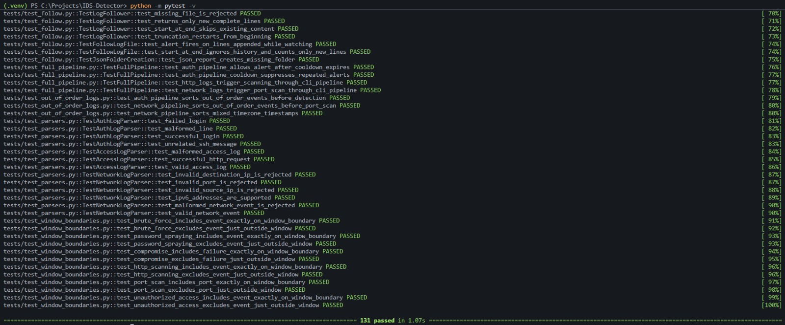
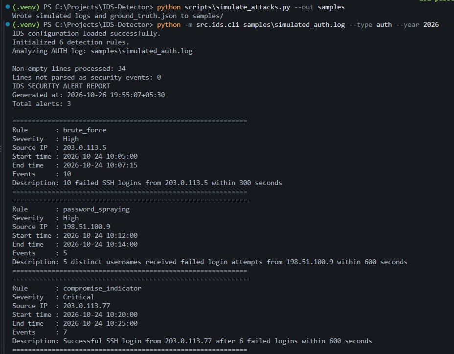
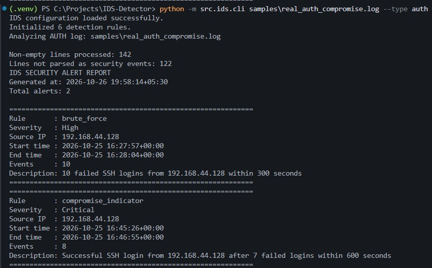
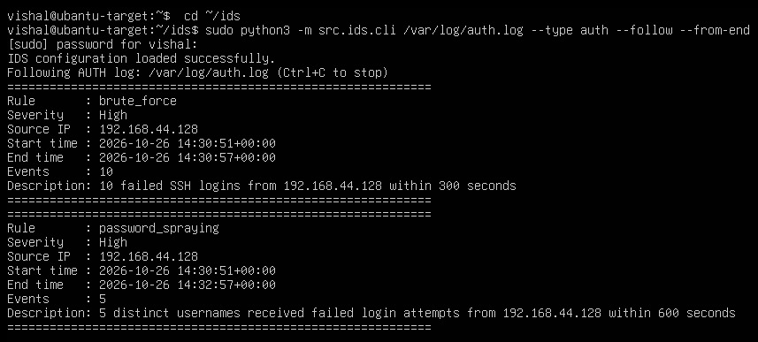

# Log-Based Intrusion Detection System (IDS)

A Python command-line tool that analyzes SSH authentication logs, Nginx/Apache access logs, and a simple custom network-event format to find suspicious patterns. It can analyze a file once, or follow a file live and print alerts as new lines arrive.

> **Scope:** This is a log analyzer, not a packet sniffer, endpoint agent, SIEM, or production monitoring service. It reads one local file at a time. Validate the rules and thresholds against your environment before relying on alerts operationally.

## Features

- SSH brute-force detection
- Password-spraying detection based on distinct usernames
- Compromise detection: a successful SSH login after repeated failures from the same source
- HTTP 404 scanning detection
- HTTP 401/403 bursts (unauthorized access)
- Port-scan detection on the custom network-event format
- Live monitoring with `--follow`, including handling of partial lines and log rotation
- Reads both classic and ISO-8601 syslog timestamps, and expands rsyslog's "message repeated N times" lines
- Source-IP allowlisting and per-rule, per-source alert cooldowns
- Configurable thresholds, time windows, and severity labels, validated on load
- Text report, JSON report (`--json`), and an exit code for scripts and CI

## Documentation

- [Architecture](docs/architecture.md): the processing pipeline, components, and design decisions.
- [Lab setup](docs/lab-setup.md): how the real-log lab was built, so the results can be reproduced.

## Requirements

- Python 3.10 or later
- PyYAML (runtime)
- pytest (tests only)

## Setup

From the project root (PowerShell on Windows):

```powershell
python -m venv .venv
.venv\Scripts\Activate.ps1
python -m pip install -r requirements-dev.txt
```

If PowerShell blocks activation, run `Set-ExecutionPolicy -Scope CurrentUser RemoteSigned` once, or call `.venv\Scripts\python.exe` directly.

## Run the detector

Run commands from the project root:

```powershell
python -m src.ids.cli path\to\auth.log --type auth
python -m src.ids.cli path\to\access.log --type http
python -m src.ids.cli path\to\network.log --type network
```

Supported `--type` values:

- `auth`: SSH lines from `sshd`, in classic syslog (`Oct 25 16:19:33 host sshd[...]`) or ISO-8601 syslog (`2026-10-25T16:19:33+00:00 host sshd[...]`) format.
- `http`: Apache/Nginx combined-format access logs.
- `network`: the custom four-field format described below.

Options:

- `--year 2026`: year to assume for classic syslog lines, which omit it. Defaults to the current year. ISO lines already include the year.
- `--json alerts.json`: also writes alerts and line counts to a JSON file. Missing folders are created.
- `--follow`: keep watching the file and print alerts as they happen (see Live monitoring).

Exit codes: `0` when no High or Critical alerts fire, `1` when at least one does, `2` for usage or input errors.

Example with the bundled samples:

```powershell
python -m src.ids.cli samples\simulated_auth.log --type auth --year 2026 --json reports\auth.json
```

The default configuration is loaded from `config.yaml` in the project root.

## Live monitoring

`--follow` analyzes the existing file, then keeps reading new lines and prints each alert as it fires. Press Ctrl+C to stop; a summary is printed at the end.

```powershell
python -m src.ids.cli samples\simulated_auth.log --type auth --follow
python -m src.ids.cli samples\simulated_auth.log --type auth --follow --from-end --interval 0.5
```

- `--from-end` skips the existing content and watches only new lines.
- `--interval` sets how often the file is checked, in seconds (default 1.0).
- Partial lines are held until their newline arrives.
- If the log is rotated or truncated, the follower restarts from the beginning.

Live monitoring follows one local file. For remote machines, you would forward logs to a central place first.

## Custom network-event format

Each non-empty line must contain exactly four whitespace-separated fields:

```text
2026-10-24T10:00:00 192.168.1.100 192.168.1.1 443
```

1. ISO-8601 timestamp (with or without a timezone offset)
2. Source IP address
3. Destination IP address
4. Destination port (1–65535)

This is a custom format. It is **not** a firewall log, PCAP, or network-flow parser. The port-scan rule groups connections by source and destination IP, so one host probing many ports is flagged, while one client using different ports on many different servers is not.

## Detection rules

Defaults are set in `config.yaml`.

| Rule | Default trigger | Severity |
|---|---|---|
| SSH brute force | 10 failed SSH logins from one source within 300 seconds | High |
| Password spraying | 5 distinct usernames targeted by failed SSH logins from one source within 600 seconds | High |
| Compromise indicator | Successful SSH login after at least 5 failures from the same source within 600 seconds | Critical |
| HTTP scanning | 30 HTTP 404 responses from one source within 60 seconds | Medium |
| Port scan | 15 distinct destination ports on one destination host, contacted by one source within 60 seconds | High |
| Unauthorized access | 10 HTTP 401/403 responses from one source within 60 seconds | High |

These are heuristics, not proof of an attack. Tune thresholds for your traffic, and check alerts in context. One source IP can represent many users behind NAT or a proxy.

## Configuration

Edit `config.yaml` to change thresholds, windows, severities, alert cooldown, and the allowlist:

```yaml
alert_cooldown_seconds: 300
allowlist:
  ips:
    - "192.168.1.10"
```

Each rule needs `threshold`, `window_seconds`, and `severity`. Thresholds and windows must be positive integers, the cooldown must be a non-negative integer, and allowlist entries must be valid IP addresses. Unknown keys in a rule (such as a typo like `treshold`) are rejected with a clear error.

Cooldowns apply per rule and source IP. Allowlisted sources are excluded from detection.

## Tests

From the project root:

```powershell
python -m pytest -v
```



The suite has 131 tests. They cover detector behavior and boundaries, both syslog formats, repeated-line expansion, configuration validation, alert cooldown and allowlisting, timestamp ordering, CLI behavior, JSON output, and live following (appended lines, partial lines, truncation, and starting from the end).

## Simulated evaluation

`scripts/simulate_attacks.py` writes labeled logs to `samples/`: SSH brute force, password spraying, a compromise, HTTP scanning, repeated 403s, and a port scan, mixed with benign traffic. It also writes `samples/ground_truth.json`, which lists the expected alerts and the benign sources that must stay quiet.

```powershell
python scripts\simulate_attacks.py --out samples
python -m src.ids.cli samples\simulated_auth.log --type auth --year 2026
```

Results on the bundled samples (full output in `samples/sample_report.md`):



| Log | Expected alerts | Caught | False alerts |
|---|---|---|---|
| `simulated_auth.log` | brute force, spraying, compromise | 3 of 3 | 0 |
| `simulated_access.log` | scanning, unauthorized access | 2 of 2 | 0 |
| `simulated_network.log` | port scan | 1 of 1 | 0 |

These samples were written to exercise the rules, so they show the rules work as designed, not how they perform on real traffic. The benign traps (one client touching 16 servers on 16 ports, and normal logins with one mistyped password) check for false positives.

## Lab validation

Beyond the simulated samples, the detector was run on real logs from a small lab: an Ubuntu VM running SSH and Nginx, attacked from a Kali VM, both on VMware Workstation. The attacks used Hydra and curl against the lab VM only. The logs were copied from the target and analyzed without changes.

| Scenario | Attack | Result |
|---|---|---|
| SSH brute force | 12 Hydra attempts against user `admin` | `brute_force` (High): 10 failures in about 7 seconds |
| SSH compromise | 6 wrong passwords for a real user, then the correct password | `compromise_indicator` (Critical) after 7 failed logins |
| HTTP scanning | 35 requests for missing pages | `scanning` (Medium) |
| HTTP access denied | 12 requests to a folder that returns 403 | `unauthorized_access` (High) |
| Password spraying | Hydra tried 7 usernames with one password | `password_spraying` (High) from the attacker after 5 distinct usernames |
| Live monitoring | Hydra attack while `--follow` was running | `brute_force` alert printed on the target within seconds |





Two real-world issues were found and fixed during the lab:

- **Ubuntu writes ISO-8601 timestamps** in `auth.log`, such as `2026-10-25T16:19:33+00:00`. The first version expected only the older `Oct 25 16:19:33` format, so real SSH lines were skipped.
- **rsyslog collapses repeated lines** into one entry followed by `message repeated N times`. Without expanding them, the compromise rule saw one failure instead of seven.

The spraying alert counted one earlier username (`admin`, from the brute-force run) toward its five distinct usernames, because both attacks fell inside the same 10-minute window. The rule behaves as designed, but it's worth knowing when you explain results.

Rule not yet tested on real traffic:

- **Port scanning:** works on the custom network-event format only. No lab log source produced that format.

## Current limitations

- Live monitoring follows one local file. There is no packet capture, remote log collection, background service, dashboard, or automatic response.
- SSH parsing covers the `Failed password`, `Accepted password`, and `invalid user` forms. Other sshd messages, such as key-based logins (`Accepted publickey`), are not parsed, so a compromise through a key login is not detected.
- Nginx and Apache logs must use the combined format.
- Only the three documented formats are supported. Other log lines are counted as unparsed.
- Timestamps without a timezone are treated as UTC.
- Classic syslog lines have no year. Pass `--year` for older logs. A classic-format file that spans New Year needs to be split by year first. ISO-format lines are not affected.
- In batch mode the whole file is read into memory, so very large files need changes.
- Per-source state is kept for the whole run and never evicted, so memory grows with the number of distinct source IPs.
- Passing tests does not establish production readiness. Review performance, retention, and deployment requirements before wider use.

## Project layout

```text
config.yaml
pytest.ini
requirements.txt
requirements-dev.txt
CHANGELOG.md
samples/                 # simulated logs, ground truth, sample report
scripts/
  simulate_attacks.py    # generates labeled logs
src/ids/
  cli.py                 # command-line entry point
  config.py              # configuration loading and validation
  models.py              # Event and Alert data classes
  alert_manager.py       # allowlisting and cooldowns
  follow.py              # live monitoring
  reporter.py            # text and JSON reports
  parsers/               # auth, HTTP access, and network-event parsers
  detectors/             # one file per detection rule
tests/
```

## License

Released under the MIT License. See [LICENSE](LICENSE).

## Author

Vishal Lamani

## Responsible use

Use this tool only on logs you are authorized to access. Log files can contain usernames, IP addresses, request paths, and other sensitive information, so protect them. Run attack tests only against systems you own or have explicit permission to test.
