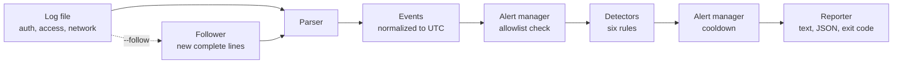

# Architecture

## Pipeline

## Components

| Module | Responsibility |
|---|---|
| `parsers/` | Turn one log line into an `Event`, or return nothing. Handles classic and ISO-8601 syslog, and expands rsyslog's repeat markers. |
| `models.py` | `Event` (what was seen) and `Alert` (what was flagged). |
| `alert_manager.py` | Skips allowlisted sources, and suppresses repeat alerts for the same rule and source during the cooldown. |
| `detectors/` | One class per rule. Each keeps its own per-source state and returns an `Alert` when its threshold is met. |
| `follow.py` | Live mode: reads only complete new lines, and restarts after truncation or rotation. |
| `config.py` | Loads `config.yaml` and rejects missing, unknown, or invalid settings before any analysis runs. |
| `reporter.py` | Writes the text summary and the JSON report. |
| `cli.py` | Entry point. Wires the modules together and sets the exit code. |

## Design decisions

- **Parse first, then sort.** Batch analysis reads the whole file, sorts events by time, and only then runs detection. Sliding windows depend on time order, so out-of-order log lines would otherwise miscount.
- **Naive timestamps are treated as UTC.** Classic syslog has no timezone, so timestamps are normalized before comparison. This avoids comparing naive and aware datetimes.
- **Sliding windows per source.** Each detector keeps the timestamps for each source IP (or source and destination pair, for port scans) and drops the ones outside its window. Memory grows with the number of distinct sources, which is listed as a limitation.
- **Thresholds live in config, not code.** Every rule's threshold, window, and severity is set in `config.yaml`, so the rules can be tuned without editing Python.
- **Cooldown lives in the manager, not the rules.** Rules report every threshold crossing, and the alert manager decides which ones to show. This keeps each rule simple and makes the suppression behavior easy to test on its own.
- **Live mode reuses the batch code.** `--follow` uses the same parsers, detectors, and alert manager. Only the input changes, so both modes behave the same way on the same lines.

## Testing

Detector boundaries (exactly at, and just outside, each window), parser edge cases, configuration validation, cooldown and allowlist behavior, out-of-order input, CLI output, and live following are each covered by tests. The suite has 131 tests.
